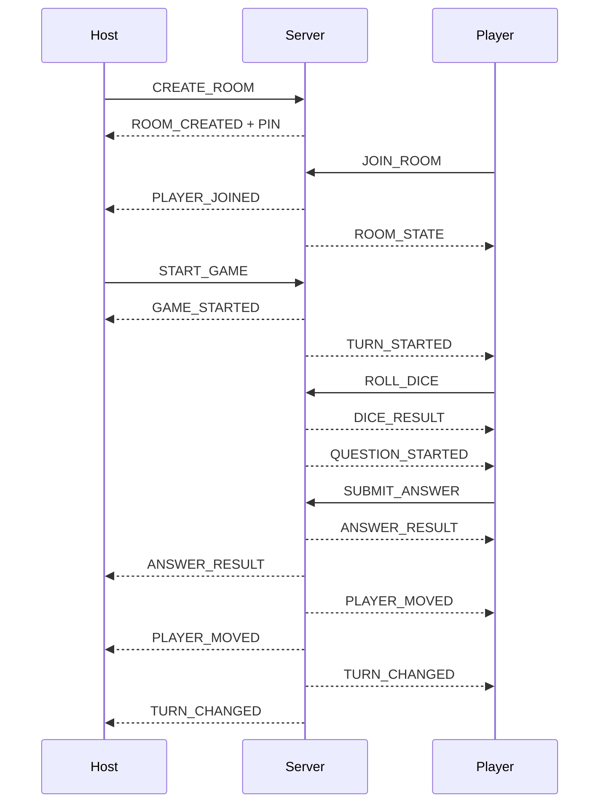
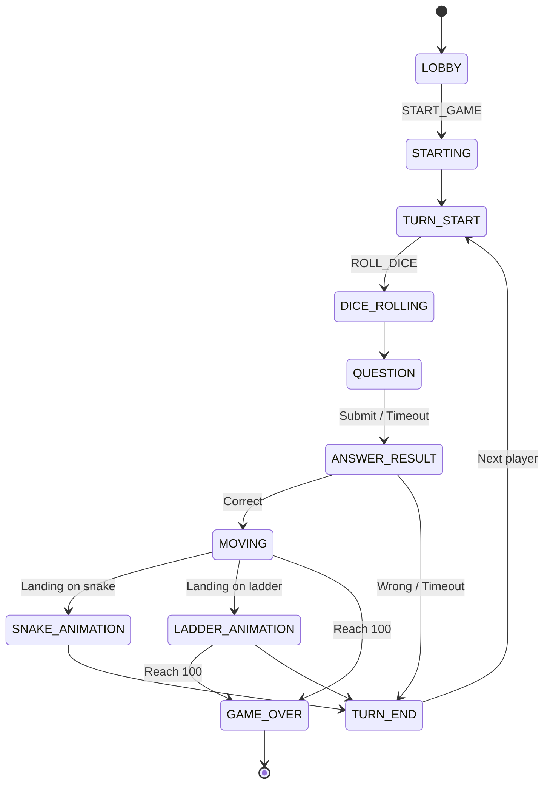

# PRD — Multiplayer Real-Time Snakes & Ladders: PUSRI Edition

- **Versi:** 1.1
- **Tanggal:** 2026-11-17
- **Status:** Draft spesifikasi produk dan teknis
- **Platform:** Web Application
- **Jenis permainan:** Multiplayer real-time, edukasi, turn-based
- **Dokumen referensi:** PRD Frontend — Multiplayer Real-Time Quiz

---

# 1. Ringkasan Produk

Snakes & Ladders: PUSRI Edition adalah permainan edukasi multiplayer berbasis web yang mengadaptasi permainan ular tangga klasik dengan mekanisme kuis interaktif bertema PT Pupuk Sriwidjaja Palembang (PUSRI).

Pemain bergabung melalui kode room, memilih karakter, kemudian bermain di papan berisi 100 kotak. Setiap giliran, pemain melempar dadu. Angka dadu menentukan jumlah langkah sekaligus tingkat kesulitan pertanyaan yang harus dijawab.

Jika jawaban benar, pemain maju sesuai angka dadu. Jika salah atau waktu habis, pemain tidak bergerak. Ketika mendarat di kotak tertentu, pemain dapat menemukan ular yang membuatnya turun atau tangga yang membawanya naik.

## 1.1 Tujuan Produk

- Menghadirkan permainan edukasi PUSRI yang menarik dan kompetitif.
- Mendukung permainan multiplayer melalui room dan kode PIN.
- Menggabungkan pengetahuan tentang PUSRI dengan mekanisme permainan ular tangga.
- Menyediakan pertanyaan buatan sendiri dan pertanyaan acak.
- Menampilkan animasi permainan yang halus dan responsif.
- Menyediakan beberapa tema peta yang masih memiliki identitas visual PUSRI.

## 1.2 Fitur Utama

1. Multiplayer room dan lobby.
2. Pemilihan karakter pemain.
3. Papan ular tangga 1–100.
4. Sistem dadu dan pertanyaan berdasarkan tingkat kesulitan.
5. Dua sumber pertanyaan: custom dan random.
6. Sistem poin berdasarkan ketepatan dan kecepatan menjawab.
7. Leaderboard real-time.
8. Lima tema peta.
9. Animasi karakter, dadu, ular, dan tangga.
10. Rekap hasil permainan.

## 1.3 Non-Goals Versi MVP

- Sistem akun dan autentikasi pengguna permanen.
- Chat antarpemain.
- Voice chat.
- Sistem turnamen dan kompetisi berjenjang.
- Marketplace karakter atau item.
- Sistem ranking global lintas room.
- Integrasi langsung dengan sistem internal PT PUSRI.
- Pembayaran atau transaksi dalam aplikasi.

---

# 2. Peran dan Alur Utama

## 2.1 Host

Host merupakan pemain yang membuat dan mengatur room permainan.

Alur:

1. Membuka halaman utama.
2. Memilih menu **Create Room**.
3. Mengatur nama room, jumlah pemain, peta, dan mode pertanyaan.
4. Memilih sumber pertanyaan: custom atau random.
5. Jika custom, memilih kumpulan pertanyaan yang telah dibuat.
6. Membuat room dan mendapatkan kode PIN.
7. Menunggu pemain bergabung di lobby.
8. Memulai permainan setelah pemain siap.
9. Melihat jalannya permainan dan leaderboard.
10. Melihat hasil akhir setelah permainan selesai.

## 2.2 Player

Player merupakan peserta yang bergabung ke dalam room.

Alur:

1. Membuka halaman utama.
2. Memasukkan kode PIN room.
3. Memasukkan nickname.
4. Memilih karakter yang tersedia.
5. Bergabung ke lobby.
6. Menekan tombol Ready.
7. Menunggu host memulai permainan.
8. Melempar dadu ketika gilirannya tiba.
9. Menjawab pertanyaan sesuai tingkat kesulitan dadu.
10. Bergerak sesuai hasil jawaban.
11. Melanjutkan giliran hingga ada pemain mencapai kotak 100.
12. Melihat hasil akhir permainan.

## 2.3 Alur Permainan



## 2.4 Game State

Status permainan yang digunakan:

| State | Keterangan |
|---|---|
| `LOBBY` | Pemain sedang bergabung dan menunggu |
| `STARTING` | Persiapan permainan |
| `TURN_START` | Memulai giliran pemain |
| `DICE_ROLLING` | Animasi dadu berlangsung |
| `QUESTION` | Pemain sedang menjawab pertanyaan |
| `ANSWER_RESULT` | Menampilkan hasil jawaban |
| `MOVING` | Karakter bergerak di papan |
| `SNAKE_ANIMATION` | Karakter turun karena ular |
| `LADDER_ANIMATION` | Karakter naik karena tangga |
| `TURN_END` | Giliran pemain selesai |
| `GAME_OVER` | Permainan selesai |

### 2.4.1 State Transition



Perpindahan state harus ditentukan server. Frontend hanya menampilkan perubahan berdasarkan event yang diterima.

---

# 3. Aturan dan Mekanisme Permainan

## 3.1 Papan Permainan

- Papan terdiri dari 100 kotak.
- Nomor kotak dimulai dari 1 hingga 100.
- Jalur bergerak dengan pola zigzag seperti permainan ular tangga klasik.
- Terdapat beberapa ular dan tangga dengan posisi yang ditentukan berdasarkan konfigurasi peta.
- Setiap pemain memiliki karakter dan posisi masing-masing.
- Semua pemain menggunakan aturan permainan yang sama meskipun memilih tema peta berbeda.

## 3.2 Sistem Dadu dan Pertanyaan

Setiap pemain mendapatkan giliran untuk melempar dadu.

Angka dadu memiliki dua fungsi:

1. Menentukan jumlah langkah yang dapat ditempuh pemain.
2. Menentukan tingkat kesulitan pertanyaan.

| Hasil Dadu | Kesulitan | Pergerakan jika benar |
|---|---|---:|
| 1 | Sangat mudah | 1 kotak |
| 2 | Mudah | 2 kotak |
| 3 | Menengah | 3 kotak |
| 4 | Menengah sulit | 4 kotak |
| 5 | Sulit | 5 kotak |
| 6 | Sangat sulit | 6 kotak |

Ketentuan:

- Pertanyaan harus sesuai dengan tingkat kesulitan hasil dadu.
- Jawaban benar membuat pemain maju sesuai angka dadu.
- Jawaban salah membuat pemain tetap di posisi sebelumnya.
- Waktu habis dianggap sebagai jawaban tidak terjawab.
- Jawaban hanya dapat dikirim satu kali.
- Pemain tidak dapat melempar dadu sebelum gilirannya tiba.

## 3.3 Sistem Ular dan Tangga

Ketika pemain berhasil menjawab pertanyaan dan bergerak:

- Jika berhenti di kotak tangga, karakter bergerak menuju kotak tujuan tangga.
- Jika berhenti di kotak ular, karakter bergerak turun menuju kotak tujuan ular.
- Jika berhenti di kotak biasa, tidak ada efek tambahan.

Contoh konfigurasi:

```json
{
  "snakes": [
    {
      "id": "snake_01",
      "from": 27,
      "to": 5
    },
    {
      "id": "snake_02",
      "from": 72,
      "to": 49
    }
  ],
  "ladders": [
    {
      "id": "ladder_01",
      "from": 8,
      "to": 31
    },
    {
      "id": "ladder_02",
      "from": 40,
      "to": 59
    }
  ]
}
```

Angka di atas merupakan contoh konfigurasi teknis, bukan posisi final ular dan tangga.

## 3.4 Kondisi Kemenangan

- Pemain harus mencapai kotak 100 untuk memenangkan permainan.
- Untuk MVP, pemain harus mendapatkan angka yang tepat agar mencapai kotak 100.
- Jika angka dadu membuat posisi pemain melewati 100, pemain tetap di posisi sebelumnya.
- Pemain pertama yang mencapai 100 menjadi pemenang.
- Setelah pemenang ditentukan, server mengirim `GAME_OVER`.

## 3.5 Sistem Skor

Skor digunakan untuk mengukur performa pemain, bukan menentukan pergerakan karakter.

Skor diberikan berdasarkan:

- Ketepatan jawaban.
- Kecepatan menjawab.
- Tingkat kesulitan pertanyaan.

Rumus awal yang direkomendasikan:

```text
time_factor = 1 - (answer_time_ms / time_limit_ms)

difficulty_multiplier = 1 + ((difficulty - 1) * 0.2)

points = round(
    1000 * time_factor * difficulty_multiplier
)
```

Ketentuan:

- Jawaban benar mendapatkan poin.
- Jawaban salah mendapatkan 0 poin.
- Tidak menjawab mendapatkan 0 poin.
- `time_factor` dibatasi antara 0 dan 1.
- Tingkat kesulitan 1 memiliki multiplier 1.0.
- Tingkat kesulitan 6 memiliki multiplier 2.0.
- Skor dihitung backend, bukan frontend.

Contoh:

| Kesulitan | Multiplier |
|---|---:|
| 1 | 1.0x |
| 2 | 1.2x |
| 3 | 1.4x |
| 4 | 1.6x |
| 5 | 1.8x |
| 6 | 2.0x |

Nilai dasar dan multiplier harus dapat diubah melalui konfigurasi backend.

Jika terdapat pemain dengan skor sama, leaderboard menggunakan jumlah jawaban benar sebagai pembanding kedua. Jika masih sama, gunakan total waktu menjawab yang lebih rendah.

---

# 4. Tema Peta dan Visual

## 4.1 Konsep Visual

Permainan memiliki beberapa tema peta yang merepresentasikan lingkungan dan aktivitas yang berkaitan dengan PUSRI.

Setiap tema memiliki:

- Background tersendiri.
- Desain papan 1–100.
- Desain ular dan tangga.
- Dekorasi lingkungan.
- Elemen visual pendukung.
- Warna dan atmosfer yang berbeda.

Mekanisme permainan tetap sama di seluruh tema.

## 4.2 Daftar Tema Peta

### A. Industrial World

Tema lingkungan industri dan pabrik pupuk.

Elemen visual:
- Area pabrik.
- Menara produksi.
- Tangki penyimpanan.
- Jaringan pipa.
- Conveyor.
- Gudang pupuk.
- Area produksi.

### B. Agricultural World

Tema dunia pertanian dan perkebunan.

Elemen visual:
- Sawah.
- Perkebunan.
- Traktor.
- Sistem irigasi.
- Petani.
- Tumpukan hasil panen.
- Lahan pertanian.

### C. Laboratory World

Tema laboratorium dan penelitian.

Elemen visual:
- Laboratorium.
- Peralatan penelitian.
- Tabung reaksi.
- Mikroskop.
- Ruang pengujian.
- Area inovasi.

### D. Distribution World

Tema distribusi dan logistik pupuk.

Elemen visual:
- Truk pengangkut.
- Kapal kargo.
- Kontainer.
- Pelabuhan.
- Gudang distribusi.
- Area pengiriman.

### E. Green Environment World

Tema lingkungan dan keberlanjutan.

Elemen visual:
- Area hijau.
- Pepohonan.
- Taman.
- Pengelolaan limbah.
- Area penghijauan.
- Elemen keselamatan dan lingkungan.

## 4.3 Aturan Asset

- Asset karakter pemain menggunakan file yang telah disediakan oleh pengguna.
- Jangan membuat ulang, mengganti, atau mengubah desain karakter utama yang telah disediakan.
- Fokus pembuatan visual baru pada papan, background, ular, tangga, dekorasi, dan elemen UI.
- Setiap peta harus memiliki identitas visual yang berbeda.
- Hindari penggunaan gambar yang terlalu ramai sehingga mengganggu keterbacaan nomor kotak.
- Seluruh elemen visual harus tetap terbaca pada desktop maupun layar yang lebih kecil.

---

# 5. Konfigurasi Integrasi

Rekomendasi arsitektur untuk implementasi multiplayer:

| Item | Teknologi / Nilai |
|---|---|
| Frontend | React + TypeScript |
| Styling | Tailwind CSS |
| Animasi UI | Framer Motion |
| Animasi papan | SVG / Canvas |
| State management | Zustand |
| Backend | Go |
| Database | PostgreSQL |
| Real-time | WebSocket |
| Format data | JSON |
| REST base URL | `https://<api-host>/api/v1` |
| WebSocket | `wss://<api-host>/ws/game` |

Teknologi di atas merupakan rekomendasi implementasi. Jika prototype dibuat menggunakan Gemini Canvas, backend multiplayer dapat disimulasikan terlebih dahulu. Fitur multiplayer lintas perangkat membutuhkan backend dan WebSocket sungguhan.

## 5.1 Aturan Sinkronisasi

- Server menjadi sumber utama seluruh state permainan.
- Posisi pemain tidak boleh ditentukan secara independen oleh frontend.
- Hasil dadu dibuat dan divalidasi server.
- Pemilihan pertanyaan dilakukan server.
- Jawaban dan skor dihitung server.
- Perpindahan pemain dikirim server.
- Frontend menjalankan animasi berdasarkan state yang diterima.
- Setiap perubahan penting memiliki `event_id` atau `sequence` agar event tidak diproses dua kali.

---

# 6. Auth dan Room Management

## 6.1 Host

Host membuat room melalui REST API.

Server mengembalikan:

- `room_id`
- `room_code`
- `host_token`
- `ws_url`

Token digunakan untuk mengakses WebSocket sebagai host.

## 6.2 Player

Player bergabung menggunakan kode room dan nickname.

Server mengembalikan:

- `player_id`
- `player_token`
- `nickname`
- `character_id`
- `ws_url`

Token pemain digunakan untuk reconnect.

## 6.3 Aturan Room

- Kode room terdiri dari 6 digit.
- Nickname wajib diisi, maksimal 20 karakter.
- Maksimal pemain default 8 orang.
- Host dapat mengatur jumlah pemain maksimal sebelum room dibuat.
- Pemain tidak dapat bergabung setelah permainan dimulai.
- Nickname tidak boleh duplikat dalam satu room.
- Host dapat memulai permainan jika minimal 2 pemain telah bergabung dan siap.
- Room yang tidak aktif dapat dihapus setelah TTL tertentu.

## 6.4 Reconnect

- Pemain yang terputus saat lobby dapat bergabung kembali menggunakan token yang sama selama room masih aktif.
- Pemain yang terputus saat permainan tetap tercatat dalam room.
- Setelah reconnect, server mengirim `STATE_SYNC`.
- Pemain tidak boleh kehilangan skor maupun posisi akibat reconnect.
- Jika koneksi host terputus, permainan tetap berjalan.
- Jika host tidak kembali, room tetap berjalan sampai permainan selesai atau kebijakan timeout host diterapkan.

---

# 7. REST API Contract

## 7.1 Format Error

Semua error REST menggunakan format:

```json
{
  "error": {
    "code": "VALIDATION_ERROR",
    "message": "nickname must be between 1 and 20 characters"
  }
}
```

Kode error umum:

- `VALIDATION_ERROR`
- `NOT_FOUND`
- `CONFLICT`
- `ROOM_FULL`
- `ROOM_ALREADY_STARTED`
- `NICKNAME_TAKEN`
- `INVALID_TOKEN`
- `INVALID_QUESTION_SET`
- `INTERNAL`

## 7.2 Daftar Endpoint

| Method | Endpoint | Keterangan |
|---|---|---|
| GET | `/api/v1/maps` | Daftar tema peta |
| GET | `/api/v1/maps/:id` | Detail peta |
| GET | `/api/v1/questions` | Daftar pertanyaan |
| POST | `/api/v1/questions` | Membuat pertanyaan |
| GET | `/api/v1/questions/:id` | Detail pertanyaan |
| PUT | `/api/v1/questions/:id` | Mengubah pertanyaan |
| DELETE | `/api/v1/questions/:id` | Menghapus pertanyaan |
| GET | `/api/v1/question-sets` | Daftar kumpulan pertanyaan |
| POST | `/api/v1/question-sets` | Membuat kumpulan pertanyaan |
| POST | `/api/v1/rooms` | Membuat room |
| GET | `/api/v1/rooms/:code` | Informasi room |
| POST | `/api/v1/rooms/:code/join` | Bergabung ke room |
| GET | `/api/v1/rooms/:code/result` | Hasil permainan |

## 7.3 Maps

```http
GET /api/v1/maps
```

Response:

```json
[
  {
    "id": "industrial_world",
    "name": "Industrial World",
    "description": "Dunia industri dan produksi pupuk",
    "thumbnail_url": "/assets/maps/industrial/thumbnail.webp",
    "is_active": true
  },
  {
    "id": "agricultural_world",
    "name": "Agricultural World",
    "description": "Dunia pertanian dan perkebunan",
    "thumbnail_url": "/assets/maps/agriculture/thumbnail.webp",
    "is_active": true
  }
]
```

Peta lain mengikuti struktur yang sama.

## 7.4 Questions

### Create Question

```http
POST /api/v1/questions
Content-Type: application/json
```

Request:

```json
{
  "question_text": "Apa fungsi utama pupuk bagi tanaman?",
  "category": "PERTANIAN",
  "difficulty": 2,
  "time_limit_sec": 20,
  "options": [
    {
      "id": "opt_01",
      "text": "Mendukung pertumbuhan tanaman",
      "is_correct": true
    },
    {
      "id": "opt_02",
      "text": "Menggantikan fungsi air",
      "is_correct": false
    },
    {
      "id": "opt_03",
      "text": "Menghilangkan kebutuhan sinar matahari",
      "is_correct": false
    },
    {
      "id": "opt_04",
      "text": "Menghentikan pertumbuhan tanaman",
      "is_correct": false
    }
  ],
  "explanation": "Pupuk menyediakan unsur hara yang dibutuhkan tanaman."
}
```

Response `201`:

```json
{
  "id": "question_001",
  "question_text": "Apa fungsi utama pupuk bagi tanaman?",
  "category": "PERTANIAN",
  "difficulty": 2,
  "time_limit_sec": 20,
  "options": [
    {
      "id": "opt_01",
      "text": "Mendukung pertumbuhan tanaman"
    },
    {
      "id": "opt_02",
      "text": "Menggantikan fungsi air"
    },
    {
      "id": "opt_03",
      "text": "Menghilangkan kebutuhan sinar matahari"
    },
    {
      "id": "opt_04",
      "text": "Menghentikan pertumbuhan tanaman"
    }
  ],
  "explanation": "Pupuk menyediakan unsur hara yang dibutuhkan tanaman."
}
```

Aturan validasi:

- `question_text` wajib diisi.
- `difficulty` bernilai 1–6.
- `time_limit_sec` bernilai 5–60.
- Jumlah opsi 2–4.
- Harus ada tepat satu jawaban benar.
- Pertanyaan harus memiliki kategori.
- Pertanyaan yang digunakan dalam permainan harus aktif.

Jawaban benar tidak boleh dikirim ke frontend sebelum pemain mengirimkan jawabannya.

### Filter Questions

```http
GET /api/v1/questions?difficulty=3&category=PUSRI&limit=10
```

Parameter:

| Parameter | Keterangan |
|---|---|
| `difficulty` | Tingkat kesulitan 1–6 |
| `category` | Kategori pertanyaan |
| `limit` | Jumlah data |
| `search` | Pencarian pertanyaan |

Endpoint pengambilan pertanyaan untuk permainan harus menghindari pengiriman jawaban benar kepada pemain.

## 7.5 Question Sets

Question Set merupakan kumpulan pertanyaan yang digunakan pada mode custom.

Contoh request:

```http
POST /api/v1/question-sets
Content-Type: application/json
```

```json
{
  "name": "PUSRI General Knowledge",
  "description": "Kumpulan pertanyaan umum tentang PUSRI",
  "question_ids": [
    "question_001",
    "question_002",
    "question_003"
  ]
}
```

Response:

```json
{
  "id": "set_001",
  "name": "PUSRI General Knowledge",
  "question_count": 3,
  "created_at": "2026-11-17T08:00:00Z"
}
```

## 7.6 Create Room

```http
POST /api/v1/rooms
Content-Type: application/json
```

Request:

```json
{
  "room_name": "PUSRI Challenge",
  "map_id": "industrial_world",
  "max_players": 8,
  "question_mode": "CUSTOM",
  "question_set_id": "set_001",
  "turn_time_limit_sec": 20
}
```

Untuk mode random:

```json
{
  "room_name": "Random PUSRI Challenge",
  "map_id": "agricultural_world",
  "max_players": 8,
  "question_mode": "RANDOM",
  "categories": ["PUSRI", "PERTANIAN", "INDUSTRI"],
  "turn_time_limit_sec": 20
}
```

Response `201`:

```json
{
  "room_id": "room_uuid",
  "room_code": "123456",
  "host_token": "opaque-host-token",
  "room_name": "PUSRI Challenge",
  "map_id": "industrial_world",
  "question_mode": "CUSTOM",
  "status": "LOBBY",
  "max_players": 8,
  "ws_url": "/ws/game?room_code=123456&role=host"
}
```

Validasi:

- `room_name` wajib.
- `map_id` harus tersedia.
- `max_players` minimal 2 dan maksimal 8.
- `question_mode` hanya `CUSTOM` atau `RANDOM`.
- Mode `CUSTOM` wajib memiliki `question_set_id`.
- Mode `RANDOM` harus memiliki pertanyaan aktif yang cukup.
- `turn_time_limit_sec` berada dalam rentang 5–60 detik.

## 7.7 Join Room

```http
POST /api/v1/rooms/:code/join
Content-Type: application/json
```

Request:

```json
{
  "nickname": "Ilham",
  "character_id": "character_01"
}
```

Response `201`:

```json
{
  "player_id": "player_uuid",
  "player_token": "opaque-player-token",
  "nickname": "Ilham",
  "character_id": "character_01",
  "position": 1,
  "score": 0,
  "ws_url": "/ws/game?room_code=123456&role=player"
}
```

Error:

- `404 NOT_FOUND`: room tidak ditemukan.
- `409 ROOM_FULL`: kapasitas room penuh.
- `409 ROOM_ALREADY_STARTED`: permainan telah dimulai.
- `409 NICKNAME_TAKEN`: nickname sudah digunakan.
- `400 VALIDATION_ERROR`: input tidak valid.

## 7.8 Get Room

```http
GET /api/v1/rooms/123456
```

Response:

```json
{
  "room_code": "123456",
  "room_name": "PUSRI Challenge",
  "status": "LOBBY",
  "map_id": "industrial_world",
  "player_count": 2,
  "max_players": 8,
  "players": [
    {
      "player_id": "player_01",
      "nickname": "Ilham",
      "character_id": "character_01",
      "ready": true
    },
    {
      "player_id": "player_02",
      "nickname": "Rizky",
      "character_id": "character_02",
      "ready": false
    }
  ]
}
```

## 7.9 Get Game Result

```http
GET /api/v1/rooms/123456/result
```

Response:

```json
{
  "room_code": "123456",
  "winner": {
    "player_id": "player_01",
    "nickname": "Ilham",
    "score": 4500
  },
  "leaderboard": [
    {
      "rank": 1,
      "player_id": "player_01",
      "nickname": "Ilham",
      "position": 100,
      "score": 4500,
      "correct_answers": 8
    },
    {
      "rank": 2,
      "player_id": "player_02",
      "nickname": "Rizky",
      "position": 76,
      "score": 3200,
      "correct_answers": 6
    }
  ],
  "total_turns": 18,
  "ended_at": "2026-11-17T09:00:00Z"
}
```

---

# 8. WebSocket Contract

## 8.1 Koneksi

Host:

```text
wss://<api-host>/ws/game?room_code=123456&role=host&token=<host_token>
```

Player:

```text
wss://<api-host>/ws/game?room_code=123456&role=player&player_id=<player_id>&token=<player_token>
```

Aturan:

- Format pesan JSON.
- Server melakukan autentikasi token.
- Server mengirim `STATE_SYNC` setelah koneksi berhasil.
- Pesan yang tidak valid akan menghasilkan `ERROR`.
- Koneksi yang terputus dapat dilakukan reconnect.
- Token tidak boleh dicatat dalam log aplikasi.

## 8.2 Message Envelope

Semua pesan menggunakan format:

```json
{
  "event": "EVENT_NAME",
  "payload": {},
  "event_id": "event_uuid",
  "timestamp": 1763360000000
}
```

`event_id` digunakan untuk identifikasi event. `timestamp` menggunakan waktu server dalam Unix milliseconds.

## 8.3 Client → Server Events

| Event | Pengirim | Payload | Keterangan |
|---|---|---|---|
| `PLAYER_READY` | Player | `{ "ready": true }` | Mengubah status siap |
| `START_GAME` | Host | `{}` | Memulai permainan |
| `ROLL_DICE` | Player | `{}` | Meminta lemparan dadu |
| `SUBMIT_ANSWER` | Player | `{"question_id":"question_001","option_id":"opt_01"}` | Mengirim jawaban |
| `SYNC` | Host/Player | `{}` | Meminta sinkronisasi |
| `END_GAME` | Host | `{}` | Mengakhiri permainan |

Server harus memvalidasi setiap event berdasarkan role pengirim dan state permainan.

## 8.4 Server → Client Events

| Event | Keterangan |
|---|---|
| `ROOM_STATE` | Kondisi room terkini |
| `PLAYER_JOINED` | Pemain baru bergabung |
| `PLAYER_LEFT` | Pemain keluar |
| `PLAYER_READY_UPDATE` | Status kesiapan pemain berubah |
| `GAME_STARTED` | Permainan dimulai |
| `TURN_STARTED` | Giliran pemain dimulai |
| `DICE_RESULT` | Hasil lemparan dadu |
| `QUESTION_STARTED` | Pertanyaan ditampilkan |
| `ANSWER_RESULT` | Hasil jawaban |
| `PLAYER_MOVED` | Pemain berpindah kotak |
| `SNAKE_TRIGGERED` | Pemain terkena ular |
| `LADDER_TRIGGERED` | Pemain mendapatkan tangga |
| `TURN_CHANGED` | Giliran berpindah |
| `LEADERBOARD_UPDATE` | Leaderboard diperbarui |
| `GAME_OVER` | Permainan selesai |
| `STATE_SYNC` | Sinkronisasi state |
| `ERROR` | Informasi error |

## 8.5 `ROOM_STATE`

Dikirim ketika pemain bergabung atau meminta sinkronisasi room.

```json
{
  "event": "ROOM_STATE",
  "payload": {
    "room_code": "123456",
    "status": "LOBBY",
    "room_name": "PUSRI Challenge",
    "map_id": "industrial_world",
    "players": [
      {
        "player_id": "player_01",
        "nickname": "Ilham",
        "character_id": "character_01",
        "ready": true
      },
      {
        "player_id": "player_02",
        "nickname": "Rizky",
        "character_id": "character_02",
        "ready": true
      }
    ],
    "max_players": 8
  }
}
```

## 8.6 `TURN_STARTED`

```json
{
  "event": "TURN_STARTED",
  "payload": {
    "turn_number": 1,
    "current_player_id": "player_01",
    "current_player_nickname": "Ilham",
    "position": 1,
    "turn_started_at": 1763360000000
  }
}
```

## 8.7 `DICE_RESULT`

```json
{
  "event": "DICE_RESULT",
  "payload": {
    "player_id": "player_01",
    "dice_value": 4,
    "difficulty": 4,
    "current_position": 1,
    "target_position": 5,
    "question_id": "question_004",
    "animation_seed": 12345
  }
}
```

`animation_seed` dapat digunakan frontend untuk menghasilkan animasi dadu yang konsisten jika diperlukan.

## 8.8 `QUESTION_STARTED`

```json
{
  "event": "QUESTION_STARTED",
  "payload": {
    "question_id": "question_004",
    "question_text": "Contoh pertanyaan tingkat kesulitan empat?",
    "difficulty": 4,
    "time_limit_sec": 20,
    "started_at_ms": 1763360001000,
    "deadline_ms": 1763360021000,
    "options": [
      {
        "id": "opt_01",
        "text": "Pilihan A"
      },
      {
        "id": "opt_02",
        "text": "Pilihan B"
      },
      {
        "id": "opt_03",
        "text": "Pilihan C"
      },
      {
        "id": "opt_04",
        "text": "Pilihan D"
      }
    ]
  }
}
```

Frontend menggunakan `deadline_ms` untuk menampilkan countdown. Validitas waktu tetap ditentukan server.

## 8.9 `SUBMIT_ANSWER`

Contoh pesan dari player:

```json
{
  "event": "SUBMIT_ANSWER",
  "payload": {
    "question_id": "question_004",
    "option_id": "opt_02"
  }
}
```

Server memeriksa:

- Apakah pengirim merupakan pemain yang sedang mendapat giliran.
- Apakah pertanyaan sedang aktif.
- Apakah waktu menjawab belum habis.
- Apakah pemain belum mengirim jawaban sebelumnya.
- Apakah opsi jawaban valid.

## 8.10 `ANSWER_RESULT`

```json
{
  "event": "ANSWER_RESULT",
  "payload": {
    "player_id": "player_01",
    "question_id": "question_004",
    "is_correct": true,
    "correct_option_id": "opt_02",
    "points_earned": 1250,
    "total_score": 1250,
    "answer_time_ms": 4500,
    "movement_allowed": true
  }
}
```

Hasil jawaban dikirim setelah server memvalidasi jawaban. Informasi jawaban benar tidak boleh dikirim sebelum pemain menjawab atau waktu habis.

## 8.11 `PLAYER_MOVED`

```json
{
  "event": "PLAYER_MOVED",
  "payload": {
    "player_id": "player_01",
    "from_position": 1,
    "to_position": 5,
    "steps": 4,
    "movement_type": "NORMAL",
    "is_finished": false
  }
}
```

`movement_type` dapat berupa:

- `NORMAL`
- `SNAKE`
- `LADDER`

## 8.12 `SNAKE_TRIGGERED`

```json
{
  "event": "SNAKE_TRIGGERED",
  "payload": {
    "player_id": "player_01",
    "snake_id": "snake_01",
    "from_position": 27,
    "to_position": 5
  }
}
```

Frontend memainkan animasi karakter meluncur turun mengikuti jalur ular.

## 8.13 `LADDER_TRIGGERED`

```json
{
  "event": "LADDER_TRIGGERED",
  "payload": {
    "player_id": "player_01",
    "ladder_id": "ladder_01",
    "from_position": 8,
    "to_position": 31
  }
}
```

Frontend memainkan animasi karakter menaiki tangga.

## 8.14 `TURN_CHANGED`

```json
{
  "event": "TURN_CHANGED",
  "payload": {
    "turn_number": 2,
    "previous_player_id": "player_01",
    "current_player_id": "player_02",
    "current_player_nickname": "Rizky"
  }
}
```

## 8.15 `LEADERBOARD_UPDATE`

```json
{
  "event": "LEADERBOARD_UPDATE",
  "payload": {
    "leaderboard": [
      {
        "rank": 1,
        "player_id": "player_01",
        "nickname": "Ilham",
        "position": 31,
        "score": 1250
      },
      {
        "rank": 2,
        "player_id": "player_02",
        "nickname": "Rizky",
        "position": 8,
        "score": 750
      }
    ]
  }
}
```

Leaderboard diperbarui setelah skor atau posisi pemain berubah.

## 8.16 `STATE_SYNC`

Dikirim setelah koneksi baru, reconnect, atau event `SYNC`.

```json
{
  "event": "STATE_SYNC",
  "payload": {
    "room_code": "123456",
    "status": "QUESTION",
    "current_turn": 3,
    "current_player_id": "player_01",
    "players": [
      {
        "player_id": "player_01",
        "nickname": "Ilham",
        "position": 12,
        "score": 1250
      },
      {
        "player_id": "player_02",
        "nickname": "Rizky",
        "position": 8,
        "score": 750
      }
    ],
    "active_question": {
      "question_id": "question_004",
      "difficulty": 4,
      "deadline_ms": 1763360021000
    },
    "server_time_ms": 1763360010000
  }
}
```

Frontend harus dapat memulihkan tampilan permainan berdasarkan data ini tanpa mengulang aksi yang telah selesai.

## 8.17 `GAME_OVER`

```json
{
  "event": "GAME_OVER",
  "payload": {
    "winner": {
      "player_id": "player_01",
      "nickname": "Ilham",
      "score": 4500
    },
    "leaderboard": [
      {
        "rank": 1,
        "player_id": "player_01",
        "nickname": "Ilham",
        "position": 100,
        "score": 4500
      },
      {
        "rank": 2,
        "player_id": "player_02",
        "nickname": "Rizky",
        "position": 76,
        "score": 3200
      }
    ],
    "ended_at_ms": 1763361000000
  }
}
```

## 8.18 `ERROR`

```json
{
  "event": "ERROR",
  "payload": {
    "code": "INVALID_STATE",
    "message": "It is not your turn"
  }
}
```

Kode error WebSocket:

- `INVALID_STATE`
- `INVALID_PAYLOAD`
- `FORBIDDEN`
- `NOT_YOUR_TURN`
- `ALREADY_ROLLED`
- `QUESTION_CLOSED`
- `ALREADY_ANSWERED`
- `INVALID_OPTION`
- `PLAYER_NOT_FOUND`
- `ROOM_NOT_FOUND`
- `UNAUTHORIZED`
- `INTERNAL`

---

# 9. Kebutuhan UI per Layar

## 9.1 Main Menu

Komponen:

- Logo dan identitas permainan.
- Tombol Create Room.
- Tombol Join Room.
- Tombol Question Bank.
- Tombol How to Play.
- Pilihan tema atau informasi peta.
- Background animasi bertema PUSRI.

## 9.2 Create Room

Form:

- Nama room.
- Pilihan map.
- Maksimal pemain.
- Mode pertanyaan.
- Pilihan Question Set jika mode custom.
- Pilihan kategori jika mode random.
- Durasi menjawab.

Validasi form mengikuti aturan backend.

## 9.3 Join Room

Komponen:

- Input kode PIN.
- Input nickname.
- Pemilihan karakter.
- Tombol Join.
- Informasi error jika PIN tidak valid atau room penuh.

## 9.4 Lobby

Komponen:

- Kode PIN besar.
- Tombol copy PIN.
- Daftar pemain.
- Avatar karakter pemain.
- Status Ready.
- Informasi jumlah pemain.
- Pilihan map.
- Tombol Start untuk host.
- Indikator koneksi.

Host tidak dapat memulai permainan jika belum memenuhi jumlah pemain minimum atau masih ada pemain yang belum siap.

## 9.5 Game Board

Komponen utama:

- Papan 1–100.
- Karakter pemain.
- Ular dan tangga.
- Informasi giliran.
- Dadu.
- Leaderboard.
- Skor pemain.
- Indikator posisi.
- Timer pertanyaan.

Papan harus memiliki tampilan yang jelas dan responsif.

## 9.6 Dice Interface

- Dadu memiliki animasi 3D atau pseudo-3D.
- Animasi hanya dimainkan setelah server menerima permintaan lemparan.
- Hasil dadu berasal dari server.
- Setelah hasil dadu diterima, tampilkan tingkat kesulitan pertanyaan.

## 9.7 Question Interface

Komponen:

- Pertanyaan.
- Empat pilihan jawaban.
- Countdown.
- Indikator kesulitan.
- Animasi feedback.
- Status jawaban.

Ketika pemain telah menjawab, seluruh pilihan dikunci.

## 9.8 Answer Result

Jika benar:

- Tampilkan feedback positif.
- Tampilkan poin yang diperoleh.
- Karakter bergerak maju sesuai hasil dadu.

Jika salah:

- Tampilkan jawaban yang benar setelah server mengirim hasil.
- Tampilkan feedback.
- Karakter tidak bergerak.

Jika waktu habis:

- Tampilkan status timeout.
- Karakter tidak bergerak.

## 9.9 Game Result

Komponen:

- Pemenang.
- Podium tiga besar.
- Leaderboard lengkap.
- Total skor.
- Total jawaban benar.
- Posisi akhir pemain.
- Tombol kembali ke menu.
- Tombol bermain kembali.

---

# 10. Animasi dan Interaksi

## 10.1 Animasi Dadu

- Dadu berputar sebelum hasil ditampilkan.
- Durasi animasi sekitar 1–2 detik.
- Angka akhir harus sesuai hasil dari server.
- Tidak boleh menghasilkan angka lokal yang berbeda dari server.

## 10.2 Animasi Karakter

- Karakter bergerak mengikuti jalur kotak.
- Pergerakan harus bertahap, bukan teleportasi.
- Kecepatan animasi harus konsisten.
- Karakter pemain lain juga harus terlihat bergerak pada semua client.
- Posisi akhir harus sesuai `PLAYER_MOVED`.

## 10.3 Animasi Ular

- Karakter bergerak mengikuti jalur ular.
- Ular dapat memiliki animasi gerakan kepala atau badan.
- Efek visual tidak boleh mengubah posisi final yang ditentukan server.

## 10.4 Animasi Tangga

- Karakter bergerak menaiki tangga.
- Gerakan harus halus.
- Posisi akhir harus sesuai data server.

## 10.5 Aturan Sinkronisasi Animasi

Animasi hanya merupakan representasi visual dari event server.

Jika animasi gagal atau client mengalami lag:

1. Jangan mengubah state permainan.
2. Ambil posisi terbaru dari server.
3. Sesuaikan tampilan karakter dengan posisi yang benar.
4. Lanjutkan permainan sesuai state server.

---

# 11. Edge Case dan Perilaku Penting

| Kasus | Perilaku Server | Perilaku Frontend |
|---|---|---|
| Host disconnect | Room tetap aktif | Tampilkan status reconnect |
| Player disconnect di lobby | Player tetap dapat reconnect selama room aktif | Tampilkan status koneksi |
| Player disconnect saat permainan | Posisi dan skor tetap disimpan | Reconnect dan sinkronisasi |
| Player mencoba melempar dadu dua kali | Tolak permintaan kedua | Nonaktifkan tombol dadu |
| Player menjawab dua kali | Terima jawaban pertama saja | Kunci pilihan |
| Player menjawab setelah deadline | Tolak jawaban | Tampilkan timeout |
| Player mencoba bergerak sendiri | Tolak event tidak sah | Ikuti posisi server |
| Room penuh | Tolak join | Tampilkan room penuh |
| Room sudah dimulai | Tolak join baru | Tampilkan permainan sudah berjalan |
| Pertanyaan tidak tersedia | Batalkan start atau gunakan kebijakan fallback yang dikonfigurasi | Tampilkan pesan error |
| Semua pemain disconnect | Room menunggu hingga timeout | Tampilkan reconnect |
| Host mengakhiri permainan | Kirim `GAME_OVER` | Tampilkan hasil akhir |
| Client menerima event duplikat | Abaikan berdasarkan event ID/sequence | Jangan memainkan animasi dua kali |
| Client menerima event tidak berurutan | Sinkronisasi ulang | Minta `STATE_SYNC` |
| Angka dadu melewati 100 | Posisi tidak berubah | Tampilkan hasil sesuai server |
| Pemain mendarat di ular | Server memindahkan ke ekor ular | Jalankan animasi turun |
| Pemain mendarat di tangga | Server memindahkan ke ujung tangga | Jalankan animasi naik |

---

# 12. Data Model

Struktur data berikut merupakan rancangan awal untuk backend.

## 12.1 Player

```json
{
  "id": "player_uuid",
  "room_id": "room_uuid",
  "nickname": "Ilham",
  "character_id": "character_01",
  "position": 1,
  "score": 0,
  "correct_answers": 0,
  "is_ready": true,
  "is_connected": true
}
```

## 12.2 Room

```json
{
  "id": "room_uuid",
  "code": "123456",
  "name": "PUSRI Challenge",
  "host_id": "player_uuid",
  "map_id": "industrial_world",
  "status": "LOBBY",
  "max_players": 8,
  "question_mode": "CUSTOM",
  "question_set_id": "set_001",
  "current_turn": 0,
  "created_at": "2026-11-17T08:00:00Z"
}
```

## 12.3 Question

```json
{
  "id": "question_001",
  "question_text": "Apa fungsi utama pupuk bagi tanaman?",
  "category": "PERTANIAN",
  "difficulty": 2,
  "time_limit_sec": 20,
  "options": [],
  "correct_option_id": "opt_01",
  "explanation": "Penjelasan jawaban."
}
```

`correct_option_id` hanya boleh diakses oleh backend sebelum jawaban pemain dinilai.

## 12.4 Game Configuration

```json
{
  "board_size": 100,
  "minimum_players": 2,
  "maximum_players": 8,
  "exact_finish": true,
  "question_time_limit_sec": 20,
  "difficulty_by_dice": {
    "1": 1,
    "2": 2,
    "3": 3,
    "4": 4,
    "5": 5,
    "6": 6
  },
  "score_base": 1000,
  "difficulty_multiplier_step": 0.2
}
```

---

# 13. Acceptance Criteria

## 13.1 Room dan Lobby

- [ ] Host dapat membuat room.
- [ ] Server menghasilkan kode PIN unik.
- [ ] Player dapat bergabung menggunakan PIN.
- [ ] Player dapat memilih karakter.
- [ ] Player dapat mengubah status Ready.
- [ ] Lobby menampilkan pemain secara real-time.
- [ ] Host dapat memulai permainan setelah syarat terpenuhi.

## 13.2 Gameplay

- [ ] Papan memiliki 100 kotak.
- [ ] Dadu menghasilkan angka 1–6 dari server.
- [ ] Angka dadu menentukan tingkat kesulitan pertanyaan.
- [ ] Pertanyaan yang ditampilkan sesuai kesulitan.
- [ ] Jawaban benar membuat karakter maju sesuai angka dadu.
- [ ] Jawaban salah tidak membuat karakter bergerak.
- [ ] Timeout tidak membuat karakter bergerak.
- [ ] Ular dan tangga bekerja sesuai konfigurasi.
- [ ] Pemain pertama yang mencapai kotak 100 menang.
- [ ] Skor dihitung oleh backend.

## 13.3 Multiplayer

- [ ] Semua pemain melihat posisi karakter yang sama.
- [ ] Semua pemain melihat giliran yang sama.
- [ ] Perubahan skor tersinkronisasi.
- [ ] Player tidak dapat melakukan aksi di luar gilirannya.
- [ ] Reconnect tidak menghilangkan posisi dan skor.
- [ ] Client dapat memulihkan state menggunakan `STATE_SYNC`.

## 13.4 Visual

- [ ] Tersedia lima tema peta.
- [ ] Setiap tema memiliki identitas visual berbeda.
- [ ] Asset karakter yang disediakan tetap digunakan.
- [ ] Animasi dadu berjalan.
- [ ] Animasi karakter berjalan halus.
- [ ] Animasi ular dan tangga berjalan.
- [ ] Tampilan responsif pada desktop dan mobile.

## 13.5 Result

- [ ] Pemenang ditampilkan.
- [ ] Leaderboard diurutkan berdasarkan skor.
- [ ] Jumlah jawaban benar ditampilkan.
- [ ] Posisi akhir pemain ditampilkan.
- [ ] Hasil permainan dapat diakses kembali selama data room masih tersedia.

---

# 14. Rencana Pengujian

1. **Unit Test**
   - Validasi pertanyaan.
   - Perhitungan skor.
   - Perhitungan pergerakan.
   - Validasi ular dan tangga.
   - Validasi state permainan.

2. **REST Integration Test**
   - Create room.
   - Join room.
   - Get room.
   - CRUD pertanyaan.
   - Create question set.
   - Get result.

3. **WebSocket Integration Test**
   - Host dan beberapa player terhubung.
   - Player ready.
   - Start game.
   - Roll dice.
   - Submit answer.
   - Player movement.
   - Turn change.
   - Game over.

4. **Reconnect Test**
   - Host disconnect.
   - Player disconnect.
   - Player reconnect saat pertanyaan aktif.
   - Sinkronisasi posisi dan skor.

5. **Gameplay Edge Test**
   - Jawaban benar.
   - Jawaban salah.
   - Timeout.
   - Mendarat di ular.
   - Mendarat di tangga.
   - Melewati kotak 100.
   - Pemain mencapai kotak 100.

6. **UI Test**
   - Responsivitas.
   - Animasi karakter.
   - Animasi dadu.
   - Animasi ular dan tangga.
   - Tampilan leaderboard.

---

# 15. Out of Scope dan Pengembangan Berikutnya

Fitur yang dapat dikembangkan setelah MVP:

- Akun dan profil pemain.
- Global leaderboard.
- Sistem achievement.
- Statistik permainan.
- Sistem level dan pengalaman.
- Item atau power-up.
- Event dan turnamen.
- Mode permainan melawan AI.
- Efek suara dan musik.
- Lebih banyak tema peta.
- Editor peta dan konfigurasi ular tangga.
- Export hasil permainan.
- Dashboard admin untuk pengelolaan pertanyaan.

---

# 16. Catatan Implementasi Penting

1. Backend merupakan sumber utama kebenaran untuk seluruh mekanisme permainan.
2. Frontend tidak boleh menentukan hasil dadu, kebenaran jawaban, skor, atau posisi akhir secara mandiri.
3. Pertanyaan harus memiliki tingkat kesulitan yang jelas dari 1 sampai 6.
4. Mode custom menggunakan kumpulan pertanyaan yang dipilih host.
5. Mode random mengambil pertanyaan dari bank pertanyaan aktif dengan tingkat kesulitan yang sesuai hasil dadu.
6. Sistem random harus menghindari pertanyaan yang sudah digunakan dalam room yang sama selama stok pertanyaan masih tersedia.
7. Pertanyaan dan jawaban harus diverifikasi sebelum dimasukkan ke bank pertanyaan. Informasi tentang PUSRI tidak boleh dibuat berdasarkan asumsi.
8. Seluruh animasi harus mengikuti event server dan tidak boleh mengubah hasil permainan.
9. Asset karakter pemain menggunakan file yang telah disediakan.
10. Prioritaskan gameplay multiplayer yang stabil sebelum menambahkan efek visual yang terlalu kompleks.

**Prioritas pengerjaan MVP:**

1. Room, PIN, lobby, dan multiplayer connection.
2. Papan 100 kotak dan sistem giliran.
3. Dadu, pertanyaan, jawaban, dan pergerakan.
4. Ular, tangga, serta kondisi kemenangan.
5. Skor dan leaderboard.
6. Lima tema peta.
7. Animasi dan penyempurnaan UI.
8. Rekap hasil permainan.